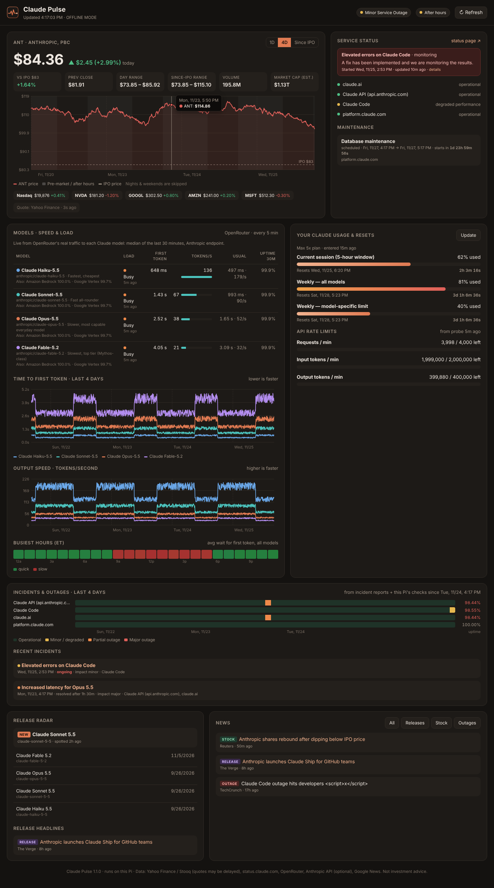

# Claude Pulse

A local dashboard for Anthropic and Claude that runs on a Raspberry Pi 5 (or any Linux machine with Python 3.9+). It uses only the Python standard library, so there's nothing to `pip install`.



*(Screenshot uses sample data.)*

**What it shows**

- **ANT stock.** Live quote, the change today and against the $83 IPO price, the day range, volume and an estimated market cap. The chart covers 1 day, 4 days or every day since the IPO, with pre-market and after-hours shaded. It also lists Nasdaq, NVDA, GOOGL, AMZN and MSFT for context.
- **Service status.** Each component on status.claude.com, live incident updates, and scheduled maintenance with countdowns.
- **Incident timeline.** A 4-day outage bar and uptime % for each component, built from incident reports plus the Pi's own checks every 2 minutes.
- **Model speed and load.** Live from OpenRouter's real traffic to each Claude model: uptime with no key, plus time to first token and tokens per second with a free OpenRouter key. Each model is compared with its usual speed and labeled Faster than usual, Normal, Busy or Very busy. Includes 4-day charts and a "busiest hours" heatmap.
- **Your usage and resets.** Countdowns for your 5-hour session and weekly limits, plus your API rate-limit headroom.
- **Release radar.** Checks the Claude model list every hour (OpenRouter's public list, or Anthropic's with a key) and flags any new model, plus headlines about releases.
- **News.** Headlines from the last week, filterable by Releases, Stock and Outages.

## Install (one line)

Open a terminal on the Pi and paste:

```bash
curl -fsSL https://raw.githubusercontent.com/CharlesPhillips3/claude-pulse/main/get.sh | bash
```

To **update**, press the **⬆ Update** button at the top of the dashboard. It turns orange when a new version is on GitHub, installs it, restarts the app and reloads the page. Running the same line again works too. Either way, your settings and history are kept.

Or install from a clone:

```bash
git clone https://github.com/CharlesPhillips3/claude-pulse.git && cd claude-pulse && ./install.sh
```

The installer:

- copies the app to `~/claude-pulse`
- sets up a background service (`claude-pulse`) that starts on boot
- puts a **Claude Pulse icon on your desktop** and in the app menu (Internet section)
- optionally asks for a free OpenRouter key and an Anthropic API key (both can be skipped)

Then double-click the desktop icon, or browse to `http://localhost:8787`. Other devices on your network can use `http://<pi-ip>:8787`.

## Model speed: free OpenRouter key (recommended)

Without any key, the dashboard already shows each Claude model's live uptime from OpenRouter.

For speed numbers (time to first token and tokens/second):

1. Sign in at https://openrouter.ai/settings/keys and click **Create Key**. It's free, and reading these stats needs no credits.
2. Paste it when the installer asks, or put it in `~/.config/claude-pulse/config.json` as `"openrouter_api_key": "sk-or-..."`.
3. Run `sudo systemctl restart claude-pulse`.

The app picks the newest Haiku, Sonnet, Opus and Fable/Mythos models automatically. To choose them yourself, list OpenRouter model ids in `openrouter_models`.

## Anthropic API key (optional extras)

An Anthropic key (console.anthropic.com) adds:

- your own **API rate-limit** headroom
- **instant new-model alerts** from Anthropic's own model list
- your own speed probes, if you want them alongside OpenRouter's numbers

Put it in the config as `"anthropic_api_key"`. The probes send each model a tiny request every `probe_interval_min` minutes (default 15), about a cent a day. The speed table uses OpenRouter's numbers when it has them, and your probes otherwise.

## Why plan usage is typed in

Claude doesn't offer an API for claude.ai plan usage. To fill it in:

1. Open **Settings → Usage** in Claude.
2. Press **Update** on the dashboard and type in the percentages and reset times.

The countdowns then run on their own. When the weekly reset passes, it rolls forward 7 days automatically. When the 5-hour session reset passes, the session shows as reset.

## Handy commands

```bash
systemctl status claude-pulse          # is it running?
journalctl -u claude-pulse -f          # live log
sudo systemctl restart claude-pulse    # after editing the config
./uninstall.sh                         # remove (add --purge to delete history + config)
```

To change the port, set `"port"` in the config and re-run `./install.sh`, so the desktop icon points to the new port.

## Data sources and limits

- **Quotes:** Yahoo Finance's public chart endpoint, falling back to Nasdaq.com's quote API and then Stooq. Quotes can be delayed and this isn't investment advice.
- **Market hours:** The app knows the 2026–2027 Nasdaq holidays and early closes.
- **Status:** status.claude.com's public Statuspage API, falling back to status.anthropic.com.
- **Model speed and uptime:** OpenRouter's public endpoint stats (30-minute medians).
- **News:** Google News RSS.
- **History:** stored in `~/.local/share/claude-pulse/pulse.db` (SQLite) and kept for 45 days. The 4-day charts for speed and the Pi's own status checks fill in as the app runs. Stock history and incident reports are available right away.
